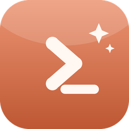

<div align="center">



# cc-session

**Claude Code Session 管理器 / Session Manager**

零第三方依赖的 Windows 桌面工具，用来浏览、搜索、续跑本机所有 Claude Code 会话。

[中文](#中文) · [English](#english) · [日本語](#日本語) · [한국어](#한국어) · [Français](#français)

</div>

---

## 中文

### 简介

Claude Code 会把每次会话记录在 `~/.claude/projects/<项目>/<sessionId>.jsonl`。日子久了，几百个会话散落在几十个项目目录里，想找回「上周改支付逻辑的那次对话」几乎不可能。

cc-session 扫描这些记录，用一个表格把它们全部列出来——名称、所属项目、执行目录、创建时间、最后更新时间——支持搜索、筛选、排序、分页，选中即可看到这个会话做过什么，点一下就能在原来的工作目录里 `claude --resume` 继续。

纯 Python + tkinter 实现，**零第三方依赖**。

### 功能

| 功能 | 说明 |
|------|------|
| 会话列表 | 名称／项目／执行目录／创建时间／最后更新，默认按更新时间倒序 |
| 搜索与筛选 | 关键词搜索、项目下拉（可输入模糊匹配）、执行目录下拉 |
| 排序与分页 | 点击表头排序，每页条数可配置（默认 40） |
| 会话摘要 | 选中后解析全文：消息数、工具调用统计、涉及文件、持续时长、用户提问回顾 |
| 继续执行 | 打开终端（优先 Windows Terminal）并 `claude --resume <id>` |
| 置顶与重命名 | 右键固定常用会话、给会话起自己的名字（不改动原始记录） |
| 打开目录 / 删除 | 右键直达工作目录，或删除会话记录文件 |
| 日报 / 周报 | 一键调起 `daily-report` / `weekly-report` 技能生成报告 |
| 登录保护 | 可选密码登录，支持修改密码 |
| 开机自启 | 写入注册表 `Run` 项，可在设置中开关 |

### 环境要求

- Windows 10 / 11
- Python 3.8+（需包含 tkinter，官方安装包默认自带）
- 已安装 Claude Code CLI（`claude` 命令可用）

### 快速开始

```bash
# 源码运行
python src/session_manager.py
```

或双击 `scripts/启动.bat`（自动选用 `pyw` / `py` / `python`，无控制台窗口）。

### 打包成 EXE

双击 `scripts/打包.bat`，脚本会自动完成：安装 PyInstaller → 版本号 +0.1 → 单文件 windowed 打包，产物为项目根目录下的 `cc-session-v<版本号>.exe`。

### 配置

运行时配置写在 `config/config.json`（含登录密码哈希与个人偏好，**已被 .gitignore 排除**）：

| 配置项 | 默认值 |
|--------|--------|
| 每页条数 | 40 |
| 窗口尺寸 | 1650 × 930 |
| 启动需要密码 | 是（首次运行自动初始化默认密码，登录后请立即修改） |
| 开机自启 | 否 |

### 目录结构

```
cc-session/
├─ src/session_manager.py   # 全部逻辑（单文件）
├─ scripts/启动.bat          # 一键运行
├─ scripts/打包.bat          # 一键打包 EXE
├─ scripts/bump_version.py  # 打包前自动升版号
├─ scripts/make_logo.py     # 生成 logo
└─ assets/                  # 图标资源
```

### 注意

- 日报／周报的输出目录在 `src/session_manager.py` 顶部硬编码（`DAILY_DIR` / `WEEKLY_DIR`），请按自己的路径修改。
- 「继续执行」使用 `--dangerously-skip-permissions` 启动，会跳过 Claude Code 的权限确认，请确认你了解其含义。
- 删除会话会**直接删除** `.jsonl` 记录文件，不可恢复。

---

## English

### Overview

Claude Code stores every conversation as `~/.claude/projects/<project>/<sessionId>.jsonl`. After a few months you have hundreds of sessions scattered across dozens of project folders, and finding "that chat where I reworked the payment logic" becomes hopeless.

cc-session scans those records and lists them in a single table — name, project, working directory, created, last updated — with search, filtering, sorting and pagination. Select a row to see what the session actually did; click once to `claude --resume` it in its original working directory.

Pure Python + tkinter, **zero third-party dependencies**.

### Features

| Feature | Description |
|---------|-------------|
| Session list | Name / project / working dir / created / last updated, newest first |
| Search & filter | Keyword search, project dropdown (type to fuzzy-match), working-dir dropdown |
| Sort & paginate | Click any column header to sort; page size configurable (default 40) |
| Session summary | Full parse on selection: message count, tool-call stats, files touched, duration, your prompts |
| Resume | Opens a terminal (Windows Terminal preferred) and runs `claude --resume <id>` |
| Pin & rename | Right-click to pin frequent sessions or give them your own name (originals untouched) |
| Open folder / delete | Jump straight to the working directory, or delete the session record |
| Daily / weekly report | One click to invoke the `daily-report` / `weekly-report` skills |
| Login protection | Optional password login with password change |
| Run at startup | Registers under the Windows `Run` registry key; toggled in Settings |

### Requirements

- Windows 10 / 11
- Python 3.8+ with tkinter (bundled with the official installer)
- Claude Code CLI installed (`claude` on PATH)

### Quick start

```bash
python src/session_manager.py
```

Or double-click `scripts/启动.bat`, which picks `pyw` / `py` / `python` automatically and starts without a console window.

### Building an EXE

Double-click `scripts/打包.bat`. It installs PyInstaller if needed, bumps the version by 0.1, and produces a single-file windowed `cc-session-v<version>.exe` in the project root.

### Configuration

Runtime settings live in `config/config.json` (contains the password hash and personal preferences — **excluded via .gitignore**):

| Setting | Default |
|---------|---------|
| Page size | 40 |
| Window size | 1650 × 930 |
| Require password | Yes (a default password is initialised on first run — change it immediately) |
| Run at startup | No |

### Layout

```
cc-session/
├─ src/session_manager.py   # entire application (single file)
├─ scripts/启动.bat          # run
├─ scripts/打包.bat          # build EXE
├─ scripts/bump_version.py  # auto version bump before build
├─ scripts/make_logo.py     # logo generator
└─ assets/                  # icons
```

### Notes

- Report output directories are hard-coded at the top of `src/session_manager.py` (`DAILY_DIR` / `WEEKLY_DIR`) — change them to your own paths.
- Resume launches Claude Code with `--dangerously-skip-permissions`, which bypasses permission prompts. Make sure you understand the implication.
- Deleting a session **permanently removes** its `.jsonl` file.

---

## 日本語

### 概要

Claude Code は会話ごとの記録を `~/.claude/projects/<プロジェクト>/<sessionId>.jsonl` に保存します。数か月も使えば、数十のプロジェクトフォルダに数百のセッションが散らばり、「先週決済処理を直したあの会話」を探し出すのは至難の業です。

cc-session はこれらの記録を走査し、名前・プロジェクト・作業ディレクトリ・作成日時・最終更新日時を一つの表にまとめます。検索・絞り込み・並べ替え・ページングに対応し、行を選べばそのセッションで何をしたかが分かり、クリック一つで元の作業ディレクトリのまま `claude --resume` で再開できます。

Python + tkinter のみ、**サードパーティ依存はゼロ**です。

### 機能

| 機能 | 説明 |
|------|------|
| セッション一覧 | 名前／プロジェクト／作業ディレクトリ／作成日時／最終更新（更新の新しい順） |
| 検索・絞り込み | キーワード検索、プロジェクト選択（入力であいまい検索）、作業ディレクトリ選択 |
| 並べ替え・ページング | 見出しクリックで並べ替え、1 ページ件数は設定可能（既定 40） |
| セッション要約 | 選択時に全文解析：メッセージ数、ツール呼び出し統計、対象ファイル、所要時間、入力した指示 |
| 再開 | 端末（Windows Terminal 優先）を開き `claude --resume <id>` を実行 |
| ピン留め・改名 | 右クリックでよく使うセッションを固定、独自の名前を付与（元記録は変更しません） |
| フォルダを開く・削除 | 作業ディレクトリを直接開く、またはセッション記録を削除 |
| 日報・週報 | ワンクリックで `daily-report` / `weekly-report` スキルを起動 |
| ログイン保護 | 任意のパスワードログイン、パスワード変更に対応 |
| 自動起動 | Windows のレジストリ `Run` に登録（設定で切替） |

### 動作環境

- Windows 10 / 11
- Python 3.8 以上（tkinter 同梱、公式インストーラなら既定で含まれます）
- Claude Code CLI がインストール済み（`claude` コマンドが使えること）

### クイックスタート

```bash
python src/session_manager.py
```

または `scripts/启动.bat` をダブルクリック（`pyw` / `py` / `python` を自動選択、コンソールなしで起動）。

### EXE のビルド

`scripts/打包.bat` をダブルクリックすると、PyInstaller の導入 → バージョン +0.1 → 単一ファイル windowed ビルドまで自動で行い、プロジェクト直下に `cc-session-v<バージョン>.exe` を生成します。

### 設定

実行時設定は `config/config.json` に保存されます（パスワードハッシュと個人設定を含むため、**.gitignore で除外済み**）。

| 項目 | 既定値 |
|------|--------|
| 1 ページ件数 | 40 |
| ウィンドウサイズ | 1650 × 930 |
| 起動時パスワード | 有効（初回起動時に既定パスワードを自動設定。ログイン後すぐ変更してください） |
| 自動起動 | 無効 |

### 構成

```
cc-session/
├─ src/session_manager.py   # 全ロジック（単一ファイル）
├─ scripts/启动.bat          # 起動
├─ scripts/打包.bat          # EXE ビルド
├─ scripts/bump_version.py  # ビルド前の自動バージョン更新
├─ scripts/make_logo.py     # ロゴ生成
└─ assets/                  # アイコン
```

### 注意

- 日報／週報の出力先は `src/session_manager.py` 冒頭（`DAILY_DIR` / `WEEKLY_DIR`）にハードコードされています。各自の環境に合わせて変更してください。
- 「再開」は `--dangerously-skip-permissions` 付きで起動し、権限確認を省略します。意味を理解した上でご利用ください。
- セッションの削除は `.jsonl` ファイルを**完全に削除**します。復元できません。

---

## 한국어

### 개요

Claude Code는 모든 대화를 `~/.claude/projects/<프로젝트>/<sessionId>.jsonl` 에 기록합니다. 몇 달만 지나면 수십 개의 프로젝트 폴더에 수백 개의 세션이 흩어져, "지난주에 결제 로직을 고쳤던 그 대화"를 찾는 일은 사실상 불가능해집니다.

cc-session은 이 기록들을 훑어 이름·프로젝트·작업 디렉터리·생성 시각·최종 수정 시각을 하나의 표로 보여 줍니다. 검색·필터·정렬·페이지 이동을 지원하고, 행을 선택하면 해당 세션이 무엇을 했는지 요약해 주며, 클릭 한 번으로 원래 작업 디렉터리에서 `claude --resume`으로 이어서 실행할 수 있습니다.

순수 Python + tkinter, **외부 의존성 없음**.

### 기능

| 기능 | 설명 |
|------|------|
| 세션 목록 | 이름 / 프로젝트 / 작업 디렉터리 / 생성 / 최종 수정 (최신순) |
| 검색·필터 | 키워드 검색, 프로젝트 선택(입력 시 유사 검색), 작업 디렉터리 선택 |
| 정렬·페이지 | 헤더 클릭 정렬, 페이지당 건수 설정 가능(기본 40) |
| 세션 요약 | 선택 시 전체 분석: 메시지 수, 도구 호출 통계, 관련 파일, 소요 시간, 입력한 지시 |
| 이어서 실행 | 터미널(Windows Terminal 우선)을 열고 `claude --resume <id>` 실행 |
| 고정·이름 변경 | 우클릭으로 자주 쓰는 세션 고정, 원하는 이름 지정(원본 기록은 그대로) |
| 폴더 열기·삭제 | 작업 디렉터리 바로 열기 또는 세션 기록 삭제 |
| 일간·주간 보고서 | 클릭 한 번으로 `daily-report` / `weekly-report` 스킬 실행 |
| 로그인 보호 | 선택적 비밀번호 로그인 및 비밀번호 변경 |
| 시작 프로그램 등록 | Windows 레지스트리 `Run` 키에 등록(설정에서 전환) |

### 요구 사항

- Windows 10 / 11
- Python 3.8 이상 (tkinter 포함, 공식 설치 프로그램에 기본 포함)
- Claude Code CLI 설치 (`claude` 명령 사용 가능)

### 빠른 시작

```bash
python src/session_manager.py
```

또는 `scripts/启动.bat` 더블클릭 (`pyw` / `py` / `python` 자동 선택, 콘솔 창 없이 실행).

### EXE 빌드

`scripts/打包.bat`를 더블클릭하면 PyInstaller 설치 → 버전 +0.1 → 단일 파일 windowed 빌드가 자동으로 진행되어, 프로젝트 루트에 `cc-session-v<버전>.exe`가 생성됩니다.

### 설정

실행 설정은 `config/config.json`에 저장됩니다(비밀번호 해시와 개인 설정 포함 — **.gitignore로 제외됨**).

| 항목 | 기본값 |
|------|--------|
| 페이지당 건수 | 40 |
| 창 크기 | 1650 × 930 |
| 시작 시 비밀번호 | 사용 (최초 실행 시 기본 비밀번호가 설정되며, 로그인 후 즉시 변경하세요) |
| 시작 프로그램 | 사용 안 함 |

### 구조

```
cc-session/
├─ src/session_manager.py   # 전체 로직 (단일 파일)
├─ scripts/启动.bat          # 실행
├─ scripts/打包.bat          # EXE 빌드
├─ scripts/bump_version.py  # 빌드 전 버전 자동 증가
├─ scripts/make_logo.py     # 로고 생성
└─ assets/                  # 아이콘
```

### 주의

- 보고서 출력 경로는 `src/session_manager.py` 상단(`DAILY_DIR` / `WEEKLY_DIR`)에 하드코딩되어 있습니다. 각자 환경에 맞게 수정하세요.
- "이어서 실행"은 `--dangerously-skip-permissions` 옵션으로 실행되어 권한 확인을 건너뜁니다. 의미를 이해한 뒤 사용하세요.
- 세션 삭제는 `.jsonl` 파일을 **영구 삭제**하며 복구할 수 없습니다.

---

## Français

### Présentation

Claude Code enregistre chaque conversation dans `~/.claude/projects/<projet>/<sessionId>.jsonl`. Au bout de quelques mois, des centaines de sessions se retrouvent dispersées dans des dizaines de dossiers de projets, et remettre la main sur « cette discussion où j'ai revu la logique de paiement » devient impossible.

cc-session parcourt ces enregistrements et les présente dans un tableau unique — nom, projet, répertoire de travail, date de création, dernière mise à jour — avec recherche, filtres, tri et pagination. Sélectionnez une ligne pour voir ce que la session a réellement fait, puis reprenez-la d'un clic avec `claude --resume`, dans son répertoire de travail d'origine.

Python + tkinter uniquement, **aucune dépendance tierce**.

### Fonctionnalités

| Fonctionnalité | Description |
|----------------|-------------|
| Liste des sessions | Nom / projet / répertoire / création / dernière mise à jour (plus récentes d'abord) |
| Recherche et filtres | Recherche par mot-clé, liste des projets (saisie avec correspondance floue), liste des répertoires |
| Tri et pagination | Tri par clic sur l'en-tête, nombre d'éléments par page configurable (40 par défaut) |
| Résumé de session | Analyse complète à la sélection : nombre de messages, statistiques d'outils, fichiers concernés, durée, vos instructions |
| Reprise | Ouvre un terminal (Windows Terminal en priorité) et lance `claude --resume <id>` |
| Épingler et renommer | Clic droit pour épingler les sessions fréquentes ou leur donner votre propre nom (l'enregistrement d'origine reste intact) |
| Ouvrir le dossier / supprimer | Accès direct au répertoire de travail, ou suppression de l'enregistrement |
| Rapports quotidiens / hebdomadaires | Lance en un clic les compétences `daily-report` / `weekly-report` |
| Protection par mot de passe | Connexion facultative par mot de passe, avec changement possible |
| Démarrage automatique | Inscription dans la clé de registre `Run` de Windows (activable dans les réglages) |

### Prérequis

- Windows 10 / 11
- Python 3.8+ avec tkinter (inclus dans l'installateur officiel)
- Claude Code CLI installé (commande `claude` disponible)

### Démarrage rapide

```bash
python src/session_manager.py
```

Ou double-cliquez sur `scripts/启动.bat`, qui choisit automatiquement `pyw` / `py` / `python` et démarre sans fenêtre de console.

### Compilation en EXE

Double-cliquez sur `scripts/打包.bat` : le script installe PyInstaller si nécessaire, incrémente la version de 0.1 et produit un exécutable `cc-session-v<version>.exe` en un seul fichier (mode fenêtré) à la racine du projet.

### Configuration

Les réglages d'exécution sont stockés dans `config/config.json` (il contient l'empreinte du mot de passe et vos préférences — **exclu par .gitignore**) :

| Réglage | Valeur par défaut |
|---------|-------------------|
| Éléments par page | 40 |
| Taille de la fenêtre | 1650 × 930 |
| Mot de passe au démarrage | Oui (un mot de passe par défaut est créé au premier lancement — changez-le immédiatement) |
| Démarrage automatique | Non |

### Arborescence

```
cc-session/
├─ src/session_manager.py   # toute la logique (fichier unique)
├─ scripts/启动.bat          # lancement
├─ scripts/打包.bat          # compilation EXE
├─ scripts/bump_version.py  # incrémentation automatique de version
├─ scripts/make_logo.py     # génération du logo
└─ assets/                  # icônes
```

### Remarques

- Les répertoires de sortie des rapports sont codés en dur en haut de `src/session_manager.py` (`DAILY_DIR` / `WEEKLY_DIR`) — adaptez-les à votre environnement.
- La reprise lance Claude Code avec `--dangerously-skip-permissions`, ce qui contourne les demandes d'autorisation. Assurez-vous d'en mesurer les conséquences.
- La suppression d'une session **efface définitivement** son fichier `.jsonl`.
